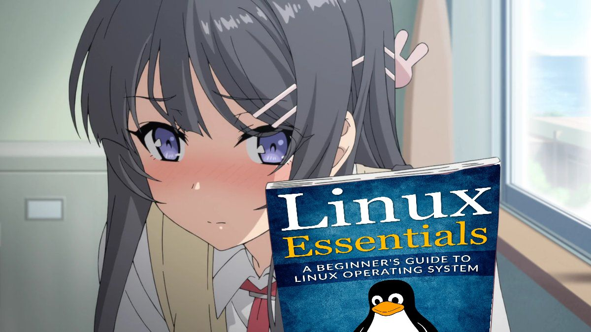

# Hi, I'm Joshan 👋

Junior Software Engineer at **Thirtyone:eight**, built on a T-Level foundation rather than a traditional degree route. Starting a BSc in Computer Science with Artificial Intelligence through the Open University in October 2026, running alongside the job rather than instead of it.

---

## Background

At sixteen, most people I knew were heading into sixth form and an A-level track built for one destination: a UCAS form two years later. I picked a T-Level instead, not because I didn't want to learn, but because I'd already found the thing I wanted to build with, and I didn't need a classroom's permission to start.

That choice put me at Amazon by seventeen, on the Prime Video team, where I:

- Built **TicketScope**, an MCP server plus a React and TypeScript frontend, learning both from a standing start. It's since been adopted company-wide.
- Led roughly 95% of the frontend for **Prime Levels**, a ten-page promotional site presented to 80+ stakeholders and built to WCAG 2.1 accessibility standards.

Alongside that, I built **NeuroNav**, an accessibility-focused revision app, as my EPQ artefact. It's had 30+ real students using it.

Two years on, that route has led to a junior engineering role and a degree I'm chasing on my own terms rather than the traditional one. Still building the whole way through.

## Currently building

- **Klokd** — a time tracker built around how a working day actually goes, not how a spreadsheet thinks it should. Node runtime, `better-sqlite3`, IPC communication.
- **Errnd** — a voice-driven assistant for the errands that fall through the cracks. *"Your errand, ran."*

# A note on the contribution graph

A fair amount of my day-to-day work now runs through Claude and other AI-assisted tooling, so a lot of what actually ships doesn't necessarily land as a neat wall of green squares the way it started before I landed Amazon. The graph undercounts the volume of things built more than it reflects the effort behind them. The pinned repos are a better signal than the heatmap.

## Elsewhere

- Portfolio: [joshan.dev](https://joshan.dev)
- Instagram: [@z3zZ](https://github.com/z3zZ)

